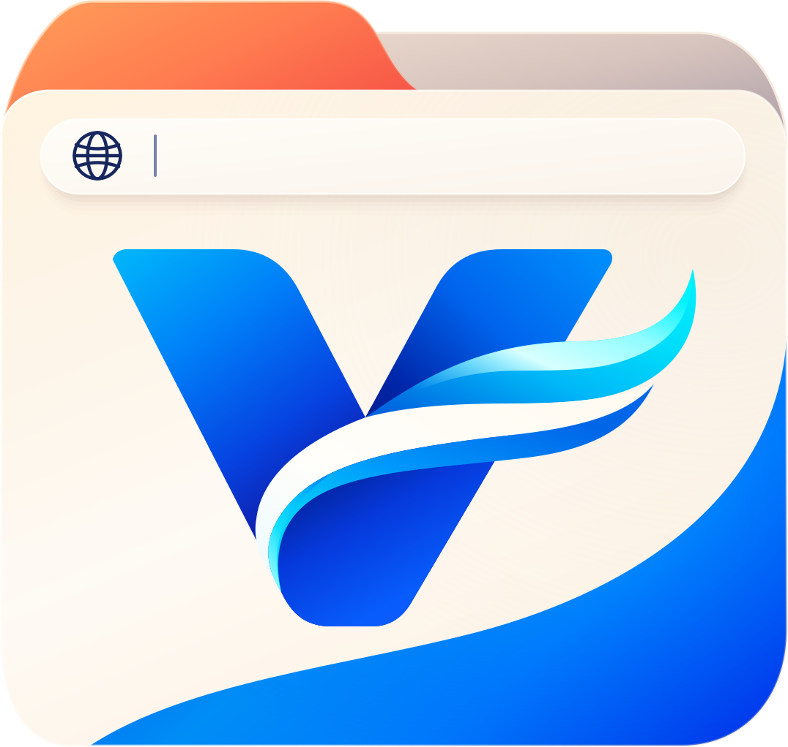

#  Vaayvu Browser

Vaayvu is an open-source browser for macOS, Windows, Android and iPhone. Its desktop app and live preview share the Electron entry point, Chromium engine, browser interface and native menus. The desktop sidebar, tab strip and toolbar use the same source in the signed Mac app.

## Use the desktop browser

- Open a new tab for the Observatory start page. Customize sits beside the Paper theme.
- Double-click a blank area of the tab bar, or right-click it, for tab actions. **Tab Bar Alignment** places tabs at the top, bottom, left or right.
- Use the left sidebar for browser navigation. Open the shield in the toolbar to see blocking for the current page.
- On a regular website, choose **View → Inspect Page**, press **F12**, or right-click and choose **Inspect element** for Chromium DevTools.

## Build and test

Use Node.js 22.13 or newer. Run these commands from the project root.

```sh
npm ci --prefix windows
npm --prefix windows exec -- install-electron
npm --prefix windows start
```

Run the shared tests with `node --test tests/*.test.cjs sync/*.test.mjs`. Use `npm --prefix windows test` to exercise a real Electron window. For the live development window use `npm --prefix windows run preview`.

| Platform | Build from source |
| --- | --- |
| macOS, Apple silicon | `npm --prefix windows run package:mac` builds the DMG and PKG using local Developer ID certificates. `npm --prefix windows run verify:mac` checks the signed app and packaged browser files. |
| Windows, x64 | `npm --prefix windows run package` produces a portable Chromium browser. `npm --prefix windows run verify` checks the archive. |
| Android | Use the Gradle wrapper under `android/` to build the APK. The app uses the device’s Chromium-based WebView. See [Android build and signing instructions](android/README.md). |
| iPhone | Open `apple/Vaayvu.xcodeproj` and select **Vaayvu iPhone**. With a registered device and development profile, run `APPLE_DEVELOPMENT_TEAM=<team-id> bash apple/scripts/package.sh device` to export an IPA. The iPhone browser uses WKWebView. |

The release folder is `tests/test/<version>/`. Run `npm --prefix windows run package:source` to export the matching source. The settings, bookmarks and regular browsing sessions live in each platform’s application data. [Desktop development guide](windows/README.md)

## Source and licensing

The shared browser UI, offline directories and blocking rules are in `chrome/`. Desktop runtime and publishing tools are in `windows/`. The optional self-hosted sync service is in `sync/`. Vaayvu’s own code uses the [MIT license](LICENSE). Third-party libraries and datasets carry their own notices in the source.
